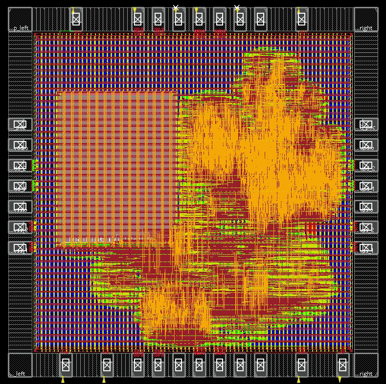

# Lab 4：逻辑综合 & 物理实现

!!! info "开始之前"
    - **主题**：Genus 逻辑综合 + Innovus 物理实现
    - **前置**：[Lab 3](lab-3.md)
    - **环境**：xlab 服务器（Cadence Genus / Innovus，TSMC180 工艺库）
    - **课时**：3 次实验课
    - **完成标准**：完成 Genus 综合与 Innovus 全部步骤，导出步骤 34.6 的交付清单。**本实验不需要提交任何材料**

本指南用于本实验包的 TSMC180 / `my_soc_top` 设计，第一部分介绍 Genus 逻辑综合，第二部分介绍从 postsyn 到 Innovus 最终导出的完整操作。已有综合结果时直接从[第二部分](#innovus)开始。

本文给出操作、命令、检查标准和必要的异常处理；各阶段列出已验证的参考结果，常见故障处理与复跑注意事项集中在本文附录。执行时以当前运行生成的日志、报告和设计数据库为验收依据。V2LVS、Virtuoso、Calibre、Seal Ring 和 Dummy Fill 属于后续软件流程，本指南到 Innovus 文件导出与核对结束。

## 实验环境与获取实验代码

实验在 xlab 服务器上进行。从共享目录把实验包复制到你自己的目录：

```bash
cp -r /lec/shared/soc_cv32e40p_template_pnr-stu ~/soc_cv32e40p_template_pnr
```

本文中的项目根目录写作 `/home/s24000xxxxx/chip-fullstack-2026/soc_cv32e40p_template_pnr`。
请把它理解为（或替换为）你复制出来的目录，例如上面的 `~/soc_cv32e40p_template_pnr`。
工艺库路径（`/home/almalinux/tsmc180/...`）是服务器上的共享路径，不需要复制。

## 使用约定与项目基线

- `bash` 代码块在 Linux 终端执行；`tcl` 代码块在 Innovus 提示符执行。Genus 的 `make` 入口自动完成综合；Innovus 的 `make` 入口只完成导入与初始化，此后按本文逐条操作。
- GUI 操作按表填写；命令逐条回车，检查结果后再进入下一步。不要整体 `source innovus_implementation.tcl` 或阶段脚本。命令中的相对路径以工具工作目录为基准。
- 本文坐标单位为 μm，Innovus 时间为 ns、电容为 pF。DEF/GDS 输出采用 2000 DBU/μm；不能直接把 DEF 整数坐标当成 μm。
- 遇到 Error、真实开路、短路或布局违规先定位；已知例外仅按本文说明处理。新运行的数量、网名和时序由新报告确定，参考结果用于对照。
- 保留 `syn/`、`src/`、`config/`、Makefile、工具脚本和工艺库。重新跑后端不需要重做综合；开始前确认没有要保留的同名输出，避免覆盖。

| 项目 | 本指南采用值 |
| --- | --- |
| 项目根目录 | `/home/s24000xxxxx/chip-fullstack-2026/soc_cv32e40p_template_pnr` |
| 顶层 / postsyn | `my_soc_top` / `syn/my_soc_top/my_soc_top_postsyn.v` |
| 工具参考 | Genus 19.17-s144_1；Innovus 21.16-s078_1 |
| 标准单元 / SRAM | `tcb018gbwp7t` / `RA1SHD_2048x32M8` |
| Die / Core | Die1800.4×1800.4；Core `(150.08,150.08)–(1650.32,1650.32)` |
| 核心 / IO 供电 | `VDD/VSS` 为 1.8 V；`VDDPST/VSSPST` 对应标称 3.3 V IO 库，四网保持独立 |
| 时钟 | `sys_clk=20 ns`、`jtag_clk=100 ns`、`virtual_jtag_tck=1000 ns` |
| 综合视图 | `func_tt_1p80v_25c`，core+SRAM |
| IO 集成后视图 | Setup/Hold 均仅 `func_tt_io`，Delay Corner=`delay_tt_io` |
| 信号布线层 | M2–M6 |
| IO 组成 | 6 信号+28 供电/POC PAD、4Corner、34Bond PAD |
| Innovus 工作目录 | `pnr/logs`；输出在 `pnr/my_soc_top/` |

<a id="genus"></a>

## 第一部分：Genus 逻辑综合

### G1：确认配置和输入

本项目的综合顶层为 `my_soc_top`，在项目根目录调用 Makefile，并保持 `TOP` 参数与配置中的顶层名称一致。若已有验收后的 postsyn，可跳过整个第一部分。

核对 `config/user_define.tcl`：`rm_core_top=my_soc_top`、`rm_clock_period=20`、`macro_insts=[list RA1SHD_2048x32M8]`、`syn_opt_level=standard`。Makefile 会比较 `TOP` 和 `rm_core_top`；不要改变解析所需的单空格格式。

输入包括 `src/filelist_syn.f` 中的 RTL、标准单元与 SRAM Liberty/LEF，以及 `config/constraints_my_soc_top.sdc`。工艺与文件路径由 `config/global_define.tcl` 定义。SDC 中实际 JTAG 时钟 100 ns、虚拟时钟 1000 ns，不能为了复现已有报告而改成同一周期。

### G2：运行综合

```bash
cd /home/s24000xxxxx/chip-fullstack-2026/soc_cv32e40p_template_pnr
mkdir -p syn/logs
make genus TOP=my_soc_top
```

入口进入 `syn/logs`，调用 `genus -abort_on_error -f ../scripts/genus_synthesis.tcl`。脚本依次读取配置和 MMMC、读取/展开 RTL、检查结构与约束、执行 `syn_generic`、`syn_map`、`syn_opt`，生成报告、门级网表、SDF 和恢复数据库。等待 `SYNTHESIS FINISHED`；该文字只是结束标记，验收仍须检查日志与报告。

### G3：检查日志、面积和时序

综合完成后，逐项打开以下日志与报告，并按表中要求检查：

| 文件 | 如何检查 |
| --- | --- |
| `syn/logs/my_soc_top.log` | 从底向上查找最后的 `Message Summary`，定位 Error/Fatal，并检查重要 Warning 的具体对象 |
| `syn/my_soc_top/reports/area/area.rpt` | 查看顶层及层次单元面积；这是综合面积报告，不是最终芯片 Die 面积 |
| `syn/my_soc_top/reports/timing/func_tt_1p80v_25c_timing.rpt` | 查看最差路径、起止点、检查类型和 slack；`MET (… ps)` 表示该条路径满足，`VIOLATED` 表示不满足 |
| `syn/my_soc_top/reports/runtime/` | 查看 elaboration、generic、map、opt 的结构检查及消息 |
| `syn/my_soc_top/reports/time_intent/` | 确认约束确实覆盖预期时钟及路径 |

本次保留的综合报告中最差展示路径为 `MET (1 ps)`，仅为参考。查看报告头的单位；Genus 此报告用 ps，不能直接与 Innovus 的 ns 数值比较。一条 MET 不代表所有模式/角都满足；当前是单 TT 教学流程。

综合的正常验收要求是无 Error/Fatal，并逐项检查重要 Warning 的具体原因及影响。本实验包保留的综合日志末尾仍有两条 `LBR-163`，因此不能把已有日志描述为零 Error，也不能将 Innovus 的 scan Error 处理决定套用于 Genus。重新综合出现库/展开错误时，回看第一次报错位置、确认库与生成网表完整性后处理，不能仅凭结束标记继续。

### G4：确认 postsyn 交接文件

```bash
ls -lh syn/my_soc_top/my_soc_top_postsyn.v
ls -lh syn/my_soc_top/my_soc_top_tt_1p80v_25c.sdf
ls -lh syn/my_soc_top/backup
```

`my_soc_top_postsyn.v` 必须非空，顶层正确，SRAM 实例及接口完整，综合日志中的异常已完成判断。Innovus 的 `init_verilog` 指向此文件；本项目以纯 core 网表导入，后续再添加外围 PAD。综合 SDF 用于综合级交付，不代替最终 PNR SDF。

需要恢复 Genus 时，在项目根目录执行 `make restore_genus TOP=my_soc_top`；这不属于从保留 postsyn 重跑 Innovus 的必要步骤。

<a id="innovus"></a>

## 第二部分：Innovus 从 postsyn 到最终导出


| 阶段 | 步骤 | 阶段完成标准 |
| --- | --- | --- |
| 导入与 Floorplan | [01–05](#step-01) | 网表、Core/Die、宏及四角核对 |
| IO 与宏固定 | [06–14](#step-06) | IO 库生效，六路信号改接、供电/Bond/IO Filler、Halo 与 10 个外部端口正确 |
| Powerplan | [15–22](#step-15) | 环、网格、SRAM 四边接入、16 个核心供电 PAD 和 M1 完成；IO 原生轨单独核查 |
| Placement | [23–26](#step-23) | Tap/Decap、Placement、Tie 和 preCTS 检查 |
| CTS | [27–29](#step-27) | 源模型明确，两棵物理树，传播时钟下 Setup/Hold 复核 |
| Routing 与 Filler | [30–33](#step-30) | 布线、自动 Hold 优化、物理/时序复核及核心 Filler |
| 最终导出 | [34](#step-34) | DEF、两种网表、SDC、SPEF/SDF、LEF 及合并 GDS |

<a id="step-01"></a>

### 步骤 01：从 postsyn 启动并确认导入

在已经配置 Cadence 工具环境的 Linux 终端执行：

```bash
cd /home/s24000xxxxx/chip-fullstack-2026/soc_cv32e40p_template_pnr
make innovus TOP=my_soc_top
```

根目录 Makefile 转到 `pnr`；`pnr/Makefile` 自动创建 logs/backup/reports，启动 Innovus 并读取 `init_pnr.tcl`。该脚本导入 postsyn、LEF、MMMC/SDC，设置单位和初始化选项；不执行 Floorplan、Placement 或 Routing。

等待 GUI 和 `Import completed: my_soc_top. Floorplan has not started.`。启动后不再 source 初始化脚本、不重复 read_sdc。切换 `Floorplan View`，快捷键 `f` 适配窗口。确认顶层与宏：

```tcl
dbGet top.name
dbGet top.insts.cell.name RA1SHD_2048x32M8
```

应为 `my_soc_top`，并存在 SRAM master。检查导入错误；默认 rows 不表示 Floorplan 已执行。

<a id="step-02"></a>

### 步骤 02：设置并核对 Core 与 Die 尺寸

打开 `Floorplan → Specify Floorplan…`：Size by=Dimension、Core Size=1500×1500 μm、Core Margins by=Core to Die、四边均 150 μm，其余默认。

执行后读取实际 Core/Die 边界。本次已验证几何为 Core (150.08,150.08)–(1650.32,1650.32)、Die (0,0)–(1800.4,1800.4)。后文固定坐标以该几何为前提；实际若不同，先重新计算。

```tcl
dbGet top.fPlan.box
dbGet top.fPlan.coreBox
```

<a id="step-03"></a>

### 步骤 03：确认 SRAM 实例与尺寸

在 `Floorplan View` 选择硬宏，按 Q 或右键 `Attribute Editor`。核对 1 个宏、实例 `i_mainmem/i_mainmem`、master `RA1SHD_2048x32M8`、尺寸 554.595×723.85 μm。本步只查属性，不摆放宏。

<a id="step-04"></a>

### 步骤 04：保存 prePad 并确定四边供电分组

用 `File → Save Design` 保存 `pnr/my_soc_top/backup/my_soc_top_prePad.enc`。检查当前为纯 core 网表，顶层为 5 输入 `clk_i/rst_ni/tck_i/tms_i/td_i` 与 1 输出 `td_o`，没有已有 PAD 时才新增。

本次每边采用以下 7 个供电 PAD，四边共 28 个：

| 类别 | Master | 网络 | 每边数量 |
| --- | --- | --- | --- |
| 核心电源 | PVDD1CDG | VDD | 2 |
| 核心地 | PVSS1CDG | VSS | 2 |
| IO 电源 | PVDD2CDG | VDDPST | 1 |
| IO 地 | PVSS2CDG | VSSPST | 1 |
| 上电控制电源 | PVDD2POC | VDDPST | 1 |

每边中部集中放供电 PAD，电源类与地类分别相邻成组。切向起点 600/700/800/900/1000/1100/1200 μm，预留 600–1260 μm 范围；这不是已经验收的封装 bonding 图。后续按步骤 09 的位置表放置。

<a id="step-05"></a>

### 步骤 05：添加并固定四个 Corner

使用 `ECO → Interactive ECO → Add Instance`，All Cells、PCORNER、顶层、FIXED。PCORNER 为 115×115 μm。Die 为 1800.4 μm 见方时：

| 实例 | X | Y | Orient |
| --- | --- | --- | --- |
| corner_bottom_left | 0 | 0 | R0 |
| corner_bottom_right | 1685.4 | 0 | MY |
| corner_top_left | 0 | 1685.4 | MX |
| corner_top_right | 1685.4 | 1685.4 | R180 |

四角应贴合 Die；位于 Core 外的提示符合外围 IO 用途。若已存在则检查，不重复添加。

<a id="step-06"></a>

### 步骤 06：加载 IO 时序库并切换活动分析视图

打开 `Timing → MMMC Browser`，新增 Library Set `lib_tt_io`。Timing Libraries 加入下列三个文件，SI Libraries 留空：

```text
/home/almalinux/tsmc180/tcb018gbwp7t_290a/TSMCHOME/digital/Front_End/timing_power_noise/NLDM/tcb018gbwp7t_270a/tcb018gbwp7ttc.lib
/home/s24000xxxxx/chip-fullstack-2026/soc_cv32e40p_template_pnr/src/macro/RA1SHD_2048x32M8/RA1SHD_2048x32M8_tt_1p8_25C_syn.lib
/home/almalinux/tsmc180/tpd018nv_280a/TSMCHOME/digital/Front_End/timing_power_noise/NLDM/tpd018nv_280a/tpd018nvtc.lib
```

新增 Delay Corner `delay_tt_io`：Library Set=`lib_tt_io`、RC Corner=`rc_tt_1p80v_25c`，OP Cond 默认、SI 关闭；Early/Late 若分开显示，两侧用同一设置。新增 Analysis View `func_tt_io`：Constraint Mode=`func`、Delay Corner=`delay_tt_io`。

Setup 与 Hold 活动列表都**只保留 `func_tt_io` 并设为 default**，从活动列表移除原有 `func_tt_1p80v_25c`，保留原有对象。应用修改并检查库加载结果。只建集合而不切活动视图不会生效；原有视图继续活动会缺 IO 定义。

<a id="step-07"></a>

### 步骤 07：添加六个信号 PAD

`ECO → Interactive ECO → Add Instance`：IO Cell（找不到则 All Cells）、PDDW0204CDG、顶层、FIXED。每个 60×115 μm；采用下表位置，避开步骤 04 的中部供电区：

| 信号 | 实例 | X | Y | Orient |
| --- | --- | --- | --- | --- |
| clk_i | i_pad_clk | 300 | 1685.4 | R180 |
| rst_ni | i_pad_rst_n | 1400 | 1685.4 | R180 |
| tck_i | i_pad_tck | 250 | 0 | R0 |
| tms_i | i_pad_tms | 450 | 0 | R0 |
| td_i | i_pad_tdi | 1400 | 0 | R0 |
| td_o | i_pad_tdo | 1600 | 0 | R0 |

确认在 Die 内、无无意重叠，并逐个核对方向；仅 box 正确不能证明方向正确（本次 preBondPad 核对曾发现底边 i_pad_tms 误为 R180）。此时还未接线。必要时单条查询：

```tcl
dbGet top.insts.name i_pad*
```

应只有上述 6 个信号实例；错误实例使用完整名称 `deleteInst` 删除，`deleteSelectedFromFPlan` 未必删除逻辑实例。

<a id="step-08"></a>

### 步骤 08：改接六路信号 PAD，并设置控制常量

先保存修改前状态：

```tcl
saveDesign ../my_soc_top/backup/my_soc_top_preIOConnect.enc
```

输入拓扑为外部端口→PAD/PAD→PAD/C→原核心负载；输出为原核心驱动→PAD/I→PAD/PAD→外部端口。切断的是顶层端口与原核心网的直接连接，不拆掉原核心网的所有负载。

逐路执行以下命令。`detachModulePort` / `attachModulePort` 后 Innovus 会重新规范化网名，所以在改接后查询实际核心网和外部网，避免硬编码 `n_1` 或 `UNCONNECTED317`。每组的两个 `set` 会回显网名：必须非空、非 `0x0`，且外部网与核心网不同；不符合时停在该组核查。

**clk_i：**

```tcl
addNet clk_i_pad
detachModulePort - clk_i
attachModulePort - clk_i clk_i_pad
set clk_i_core_net [dbGet [dbGet top.hInst.hInsts.hInstTerms.name i_dmi_jtag/clk_i -p].net.name]
set clk_i_ext_net [dbGet [dbGet top.terms.name clk_i -p].net.name]
attachTerm i_pad_clk PAD $clk_i_ext_net
attachTerm i_pad_clk C $clk_i_core_net
```

```tcl
attachTerm i_pad_clk OEN 1'b1
attachTerm i_pad_clk IE 1'b1
attachTerm i_pad_clk PE 1'b0
attachTerm i_pad_clk DS 1'b0
attachTerm i_pad_clk I 1'b0
```

**rst_ni：**

```tcl
addNet rst_ni_pad
detachModulePort - rst_ni
attachModulePort - rst_ni rst_ni_pad
set rst_ni_core_net [dbGet [dbGet top.hInst.hInsts.hInstTerms.name i_dmi_jtag/rst_ni -p].net.name]
set rst_ni_ext_net [dbGet [dbGet top.terms.name rst_ni -p].net.name]
attachTerm i_pad_rst_n PAD $rst_ni_ext_net
attachTerm i_pad_rst_n C $rst_ni_core_net
```

```tcl
attachTerm i_pad_rst_n OEN 1'b1
attachTerm i_pad_rst_n IE 1'b1
attachTerm i_pad_rst_n PE 1'b0
attachTerm i_pad_rst_n DS 1'b0
attachTerm i_pad_rst_n I 1'b0
```

**tck_i：**

```tcl
addNet tck_i_pad
detachModulePort - tck_i
attachModulePort - tck_i tck_i_pad
set tck_i_core_net [dbGet [dbGet top.hInst.hInsts.hInstTerms.name i_dmi_jtag/tck_i -p].net.name]
set tck_i_ext_net [dbGet [dbGet top.terms.name tck_i -p].net.name]
attachTerm i_pad_tck PAD $tck_i_ext_net
attachTerm i_pad_tck C $tck_i_core_net
```

```tcl
attachTerm i_pad_tck OEN 1'b1
attachTerm i_pad_tck IE 1'b1
attachTerm i_pad_tck PE 1'b0
attachTerm i_pad_tck DS 1'b0
attachTerm i_pad_tck I 1'b0
```

**tms_i：**

```tcl
addNet tms_i_pad
detachModulePort - tms_i
attachModulePort - tms_i tms_i_pad
set tms_i_core_net [dbGet [dbGet top.hInst.hInsts.hInstTerms.name i_dmi_jtag/tms_i -p].net.name]
set tms_i_ext_net [dbGet [dbGet top.terms.name tms_i -p].net.name]
attachTerm i_pad_tms PAD $tms_i_ext_net
attachTerm i_pad_tms C $tms_i_core_net
```

```tcl
attachTerm i_pad_tms OEN 1'b1
attachTerm i_pad_tms IE 1'b1
attachTerm i_pad_tms PE 1'b0
attachTerm i_pad_tms DS 1'b0
attachTerm i_pad_tms I 1'b0
```

**td_i：**

```tcl
addNet td_i_pad
detachModulePort - td_i
attachModulePort - td_i td_i_pad
set td_i_core_net [dbGet [dbGet top.hInst.hInsts.hInstTerms.name i_dmi_jtag/td_i -p].net.name]
set td_i_ext_net [dbGet [dbGet top.terms.name td_i -p].net.name]
attachTerm i_pad_tdi PAD $td_i_ext_net
attachTerm i_pad_tdi C $td_i_core_net
```

```tcl
attachTerm i_pad_tdi OEN 1'b1
attachTerm i_pad_tdi IE 1'b1
attachTerm i_pad_tdi PE 1'b0
attachTerm i_pad_tdi DS 1'b0
attachTerm i_pad_tdi I 1'b0
```

**td_o：**

```tcl
addNet td_o_pad
detachModulePort - td_o
attachModulePort - td_o td_o_pad
set td_o_core_net [dbGet [dbGet top.hInst.hInsts.hInstTerms.name i_dmi_jtag/td_o -p].net.name]
set td_o_ext_net [dbGet [dbGet top.terms.name td_o -p].net.name]
attachTerm i_pad_tdo PAD $td_o_ext_net
attachTerm i_pad_tdo I $td_o_core_net
```

```tcl
attachTerm i_pad_tdo OEN 1'b0
attachTerm i_pad_tdo IE 1'b0
attachTerm i_pad_tdo PE 1'b0
attachTerm i_pad_tdo DS 1'b0
```

检查每路顶层、PAD 和核心端的网名。以时钟为例：

```tcl
dbGet [dbGet top.terms.name clk_i -p].net.name
dbGet [dbGet top.insts.name i_pad_clk -p].instTerms.name
dbGet [dbGet top.hInst.hInsts.hInstTerms.name i_dmi_jtag/clk_i -p].net.name
saveNetlist ../my_soc_top/my_soc_top_io_connected.v
```

网表中六个 PAD/PAD 必须分别连接六个同名顶层信号，五个输入 C 接原核心网，TDO 的 I 接原核心驱动。输入控制 OEN/IE=1/1、PE/DS/I=0；输出 OEN/IE/PE/DS=0，C 未用。后续由 Tie 单元实现常量。

复位网改名为 `UNCONNECTED317` 不足以证明断线。本次 postsyn 中 `assign dmi_rst_no = trst_ni;` 引起别名规范化；导出后 PAD/C 接 n_2，g15/A1 同接 n_2，g15/ZN 接 n_7 到复位生成模块。遇到类似网名应比较 postsyn 的全部原负载和修改后连接，不因名字像“未连接”而删除/重建网络。

完整六路与复位分支核对后保存：

```tcl
saveDesign ../my_soc_top/backup/my_soc_top_postSignalPad_fixed.enc
```

<a id="step-09"></a>

### 步骤 09：添加四边 28 个供电 PAD，并检查 IO 侧别

用 `ECO → Interactive ECO → Add Instance`，按下表逐个添加到顶层并设为 FIXED。实例命名为 `i_pad_<边>_<后缀>`，例如 `i_pad_N_vss_1`。

| 后缀 | Master | 沿边坐标 t | 网络 |
| --- | --- | --- | --- |
| vss_1 | PVSS1CDG | 600 | VSS |
| vss_2 | PVSS1CDG | 700 | VSS |
| vssio | PVSS2CDG | 800 | VSSPST |
| vdd_1 | PVDD1CDG | 900 | VDD |
| vdd_2 | PVDD1CDG | 1000 | VDD |
| vddio | PVDD2CDG | 1100 | VDDPST |
| poc | PVDD2POC | 1200 | VDDPST |

| 边标识 | GUI 的 X/Y | Orient | 放置后 box 尺寸 |
| --- | --- | --- | --- |
| N | `(t,1685.4)` | R180 | 60×115 |
| S | `(t,0)` | R0 | 60×115 |
| W | `(0,t)` | R270 | 115×60 |
| E | `(1685.4,t)` | R90 | 115×60 |

每边 7 个、共 28 个。先核对每边首个，再继续余下实例。不得把左边与右边方向交换。四边均有 POC，本次位置和逻辑归属已核对；产品使用仍须符合 IO 库 POC 要求。

**IO 侧别是插入 IO Filler 的前置检查，不是启动后端必须有的文件。** GUI 添加/摆放实例后，实际 box 正确不保证 IO 侧别记录正确。先导出当前记录：

```tcl
saveIoFile -locations -includeCellName ../my_soc_top/my_soc_top_io_beforeFiller.io
```

打开导出文件：top 应有 9 个、bottom11 个、left7 个、right7 个 IO；四角分别在 topright/topleft/bottomleft/bottomright；只核对 34 个 IO 和四角，不把 Bond PAD 当 IO。

如果记录正确，直接进入步骤 10。如果错误或缺失，按下面方法**从当前实际布局自动生成约束**，不手写 IO 数据，不需要预先提供任何登记文件。实例名、master、数量、offset、indent 和方向都读取当前数据库；换设计时不改固定 PAD 表。

适用范围：矩形 Die、单圈外围 IO、四个 Corner 已贴合四角、全部 PAD/Corner 已固定；LEF 正确区分 PAD、PAD SPACER 和 CORNER。Bond PAD 为 BLOCK，不参与生成；已有 IO Filler 为 PAD SPACER，会跳过，若其位置已错误仍须先按附录 A1 删除。多圈、非矩形、内部 AREAIO 及 LEF 分类不符合上述条件的设计不直接套用；本段按 PAD 距离 Die 边界的最近边确定侧别，不能替代正确摆放和电源轨方向检查。

先保存返修前状态：

```tcl
saveDesign ../my_soc_top/backup/my_soc_top_preIORegistration.enc
```

下面代码是直接粘贴到 Innovus 终端的 Tcl 命令，不需要另建脚本文件。它读取实际 box 和方向，生成临时 IO 数据；不移动实例。循环及条件块须整块粘贴。未固定、越界、角点重复或侧别不明确时会报错，应先解决再运行；不要跳过错误直接加载其他文件。

```tcl
set io_die [lindex [dbGet top.fPlan.box] 0]
lassign $io_die io_dx0 io_dy0 io_dx1 io_dy1
set io_tol 0.001
set io_rows [dict create top {} bottom {} left {} right {}]
set io_corners [dict create]
set io_before [dict create]
foreach io_inst [dbGet top.insts] {
    set io_class [dbGet $io_inst.cell.baseClass]
    if {$io_class ni {pad corner}} {continue}
    set io_subclass [dbGet $io_inst.cell.subClass]
    if {[string match -nocase *spacer* $io_subclass]} {continue}
    set io_name [dbGet $io_inst.name]
    set io_cell [dbGet $io_inst.cell.name]
    if {[regexp {["\\]} "$io_name$io_cell"]} {
        error "IO名称含特殊引号或反斜线，请单独检查：$io_name"
    }
    if {[dbGet $io_inst.pStatus] ne "fixed"} {
        error "请先摆放并固定IO：$io_name"
    }
    set io_box [lindex [dbGet $io_inst.box] 0]
    lassign $io_box io_x0 io_y0 io_x1 io_y1
    set io_ori [dbGet $io_inst.orient]
    if {$io_x0 < $io_dx0-$io_tol || $io_y0 < $io_dy0-$io_tol ||
        $io_x1 > $io_dx1+$io_tol || $io_y1 > $io_dy1+$io_tol} {
        error "IO越出Die：$io_name"
    }
    dict set io_before $io_name [list $io_box $io_ori]
    if {$io_class eq "corner"} {
        set io_horizontal ""
        set io_vertical ""
        if {abs($io_x0-$io_dx0) < $io_tol} {set io_horizontal left}
        if {abs($io_x1-$io_dx1) < $io_tol} {set io_horizontal right}
        if {abs($io_y0-$io_dy0) < $io_tol} {set io_vertical bottom}
        if {abs($io_y1-$io_dy1) < $io_tol} {set io_vertical top}
        if {$io_horizontal eq "" || $io_vertical eq ""} {
            error "Corner没有贴合Die角点：$io_name"
        }
        set io_side "$io_vertical$io_horizontal"
        if {[dict exists $io_corners $io_side]} {
            error "同一角点出现多个Corner：$io_side"
        }
        dict set io_corners $io_side [list $io_name $io_cell $io_ori]
    } else {
        set io_distances [list \
            [list [expr {abs($io_y0-$io_dy0)}] bottom] \
            [list [expr {abs($io_dy1-$io_y1)}] top] \
            [list [expr {abs($io_x0-$io_dx0)}] left] \
            [list [expr {abs($io_dx1-$io_x1)}] right]]
        set io_distances [lsort -real -index 0 $io_distances]
        set io_indent [lindex $io_distances 0 0]
        if {[lindex $io_distances 1 0]-$io_indent < $io_tol} {
            error "PAD侧别不明确，请检查摆放：$io_name"
        }
        set io_side [lindex $io_distances 0 1]
        if {$io_side in {top bottom}} {
            set io_offset [expr {$io_x0-$io_dx0}]
        } else {
            set io_offset [expr {$io_y0-$io_dy0}]
        }
        dict lappend io_rows $io_side [list $io_offset $io_name $io_cell $io_indent $io_ori]
    }
}
if {[dict size $io_corners] != 4} {
    error "本段适用于四角齐全的矩形单圈IO，当前Corner数量不是4"
}
set io_count 0
foreach io_side {top bottom left right} {
    set io_side_count [llength [dict get $io_rows $io_side]]
    incr io_count $io_side_count
    puts "$io_side : $io_side_count PAD"
}
if {$io_count == 0} {error "没有找到CLASS PAD实例，请检查LEF分类"}
set io_tmp_path ../my_soc_top/io_registration_tmp.io
set io_fd [open $io_tmp_path w]
puts $io_fd "(globals\n version = 3\n io_order = default\n)\n(iopad"
foreach io_side {topright top topleft left bottomleft bottom bottomright right} {
    puts $io_fd " ($io_side"
    if {[dict exists $io_corners $io_side]} {
        lassign [dict get $io_corners $io_side] io_name io_cell io_ori
        puts $io_fd [format {  (inst name="%s" cell="%s" orientation=%s place_status=fixed)} $io_name $io_cell $io_ori]
    } else {
        foreach io_row [lsort -real -index 0 [dict get $io_rows $io_side]] {
            lassign $io_row io_offset io_name io_cell io_indent io_ori
            puts $io_fd [format {  (inst name="%s" cell="%s" offset=%.6f indent=%.6f orientation=%s place_status=fixed)} $io_name $io_cell $io_offset $io_indent $io_ori]
        }
    }
    puts $io_fd " )"
}
puts $io_fd ")"
close $io_fd
```

检查输出的四边数量是否符合现场布局；本设计参考 top9、bottom11、left7、right7，其他设计使用其实际数量。临时数据由上面的命令自动写出，你不需要逐个编辑。确认后加载并验证实例没有移动：

```tcl
loadIoFile $io_tmp_path -noAdjustDieSize -specifiedIosOnly
foreach io_name [dict keys $io_before] {
    set io_inst [dbGet top.insts.name $io_name -p]
    lassign [dict get $io_before $io_name] io_old_box io_old_ori
    set io_new_box [lindex [dbGet $io_inst.box] 0]
    foreach io_old_value $io_old_box io_new_value $io_new_box {
        if {abs($io_old_value-$io_new_value) > $io_tol} {
            error "加载后IO位置变化，请恢复preIORegistration检查点：$io_name"
        }
    }
    if {[dbGet $io_inst.orient] ne $io_old_ori} {
        error "加载后IO方向变化，请恢复preIORegistration检查点：$io_name"
    }
}
file delete $io_tmp_path
saveIoFile -locations -includeCellName ../my_soc_top/my_soc_top_io_registered.io
defOut ../my_soc_top/my_soc_top_io_registered.def
```

保存的 io/DEF 为运行时核查输出，不是下一次运行必须输入的文件。核对侧别和 Die 未变化后，后续步骤 12 仍是四条 addIoFiller 命令。

自动生成逻辑已依据 Innovus 21.16 数据库字段说明编写，并用本次最终 DEF 进行离线数据核对；`loadIoFile` 修正侧别的路径已在本次实际流程中验证。新增自动生成段尚未在真实 Innovus 会话内执行，因此首次使用仍需核查导出记录和加载前后几何；不将离线核对描述为新设计整轮验证。

<a id="step-10"></a>

### 步骤 10：添加 34 个 Wire Bond PAD

全部 34 个 IO 均添加一个 `PAD60LU_OBV`（60×73.16），设为 physical-only、FIXED。该单元用 M4 覆盖叠接，不调用 `attachTerm`。以下命令在新流程中各执行一次：

```tcl
addInst -physical -cell PAD60LU_OBV -inst i_bond_clk -loc {300 1727.24} -ori R180 -place_status fixed -dontSnapToPlacementGrid
addInst -physical -cell PAD60LU_OBV -inst i_bond_rst_n -loc {1400 1727.24} -ori R180 -place_status fixed -dontSnapToPlacementGrid
addInst -physical -cell PAD60LU_OBV -inst i_bond_tck -loc {250 0} -ori R0 -place_status fixed -dontSnapToPlacementGrid
addInst -physical -cell PAD60LU_OBV -inst i_bond_tms -loc {450 0} -ori R0 -place_status fixed -dontSnapToPlacementGrid
addInst -physical -cell PAD60LU_OBV -inst i_bond_tdi -loc {1400 0} -ori R0 -place_status fixed -dontSnapToPlacementGrid
addInst -physical -cell PAD60LU_OBV -inst i_bond_tdo -loc {1600 0} -ori R0 -place_status fixed -dontSnapToPlacementGrid
```

**N 边：**

```tcl
addInst -physical -cell PAD60LU_OBV -inst i_bond_N_vss_1 -loc {600 1727.24} -ori R180 -place_status fixed -dontSnapToPlacementGrid
addInst -physical -cell PAD60LU_OBV -inst i_bond_N_vss_2 -loc {700 1727.24} -ori R180 -place_status fixed -dontSnapToPlacementGrid
addInst -physical -cell PAD60LU_OBV -inst i_bond_N_vssio -loc {800 1727.24} -ori R180 -place_status fixed -dontSnapToPlacementGrid
addInst -physical -cell PAD60LU_OBV -inst i_bond_N_vdd_1 -loc {900 1727.24} -ori R180 -place_status fixed -dontSnapToPlacementGrid
addInst -physical -cell PAD60LU_OBV -inst i_bond_N_vdd_2 -loc {1000 1727.24} -ori R180 -place_status fixed -dontSnapToPlacementGrid
addInst -physical -cell PAD60LU_OBV -inst i_bond_N_vddio -loc {1100 1727.24} -ori R180 -place_status fixed -dontSnapToPlacementGrid
addInst -physical -cell PAD60LU_OBV -inst i_bond_N_poc -loc {1200 1727.24} -ori R180 -place_status fixed -dontSnapToPlacementGrid
```

**S 边：**

```tcl
addInst -physical -cell PAD60LU_OBV -inst i_bond_S_vss_1 -loc {600 0} -ori R0 -place_status fixed -dontSnapToPlacementGrid
addInst -physical -cell PAD60LU_OBV -inst i_bond_S_vss_2 -loc {700 0} -ori R0 -place_status fixed -dontSnapToPlacementGrid
addInst -physical -cell PAD60LU_OBV -inst i_bond_S_vssio -loc {800 0} -ori R0 -place_status fixed -dontSnapToPlacementGrid
addInst -physical -cell PAD60LU_OBV -inst i_bond_S_vdd_1 -loc {900 0} -ori R0 -place_status fixed -dontSnapToPlacementGrid
addInst -physical -cell PAD60LU_OBV -inst i_bond_S_vdd_2 -loc {1000 0} -ori R0 -place_status fixed -dontSnapToPlacementGrid
addInst -physical -cell PAD60LU_OBV -inst i_bond_S_vddio -loc {1100 0} -ori R0 -place_status fixed -dontSnapToPlacementGrid
addInst -physical -cell PAD60LU_OBV -inst i_bond_S_poc -loc {1200 0} -ori R0 -place_status fixed -dontSnapToPlacementGrid
```

**W 边：**

```tcl
addInst -physical -cell PAD60LU_OBV -inst i_bond_W_vss_1 -loc {0 600} -ori R270 -place_status fixed -dontSnapToPlacementGrid
addInst -physical -cell PAD60LU_OBV -inst i_bond_W_vss_2 -loc {0 700} -ori R270 -place_status fixed -dontSnapToPlacementGrid
addInst -physical -cell PAD60LU_OBV -inst i_bond_W_vssio -loc {0 800} -ori R270 -place_status fixed -dontSnapToPlacementGrid
addInst -physical -cell PAD60LU_OBV -inst i_bond_W_vdd_1 -loc {0 900} -ori R270 -place_status fixed -dontSnapToPlacementGrid
addInst -physical -cell PAD60LU_OBV -inst i_bond_W_vdd_2 -loc {0 1000} -ori R270 -place_status fixed -dontSnapToPlacementGrid
addInst -physical -cell PAD60LU_OBV -inst i_bond_W_vddio -loc {0 1100} -ori R270 -place_status fixed -dontSnapToPlacementGrid
addInst -physical -cell PAD60LU_OBV -inst i_bond_W_poc -loc {0 1200} -ori R270 -place_status fixed -dontSnapToPlacementGrid
```

**E 边：**

```tcl
addInst -physical -cell PAD60LU_OBV -inst i_bond_E_vss_1 -loc {1727.24 600} -ori R90 -place_status fixed -dontSnapToPlacementGrid
addInst -physical -cell PAD60LU_OBV -inst i_bond_E_vss_2 -loc {1727.24 700} -ori R90 -place_status fixed -dontSnapToPlacementGrid
addInst -physical -cell PAD60LU_OBV -inst i_bond_E_vssio -loc {1727.24 800} -ori R90 -place_status fixed -dontSnapToPlacementGrid
addInst -physical -cell PAD60LU_OBV -inst i_bond_E_vdd_1 -loc {1727.24 900} -ori R90 -place_status fixed -dontSnapToPlacementGrid
addInst -physical -cell PAD60LU_OBV -inst i_bond_E_vdd_2 -loc {1727.24 1000} -ori R90 -place_status fixed -dontSnapToPlacementGrid
addInst -physical -cell PAD60LU_OBV -inst i_bond_E_vddio -loc {1727.24 1100} -ori R90 -place_status fixed -dontSnapToPlacementGrid
addInst -physical -cell PAD60LU_OBV -inst i_bond_E_poc -loc {1727.24 1200} -ori R90 -place_status fixed -dontSnapToPlacementGrid
```

检查总数 34、逐一对应 IO 的 M4 外部窗口。TCK 的 box 为 `{250 0 310 73.16}`；顶边 Bond 的 y=1727.24，右边 Bond 的 x=1727.24，不能套用 IO 的 1685.4。34 处 Bond/IO 有意覆盖应保留；后续 checkPlace 若列 34 处 IO overlap，核对对象后按预期处理。

```tcl
defOut ../my_soc_top/my_soc_top_preIOFiller.def
```

<a id="step-11"></a>

### 步骤 11：绑定四个独立供电网络

先查询 IO 电源网：

```tcl
dbGet top.nets.name VDDPST
dbGet top.nets.name VSSPST
```

仅在对应网不存在时创建（已有时跳过）：

```tcl
addNet VDDPST -power
addNet VSSPST -ground
```

绑定核心 PG：

```tcl
globalNetConnect VDD -type pgpin -pin VDD -all -verbose
globalNetConnect VSS -type pgpin -pin VSS -all -verbose
```

本库 IO 电源端是普通 INOUT，需显式连接四边全部 12 个端子：

```tcl
attachTerm i_pad_N_vddio VDDPST VDDPST
attachTerm i_pad_N_poc VDDPST VDDPST
attachTerm i_pad_N_vssio VSSPST VSSPST
attachTerm i_pad_S_vddio VDDPST VDDPST
attachTerm i_pad_S_poc VDDPST VDDPST
attachTerm i_pad_S_vssio VSSPST VSSPST
attachTerm i_pad_W_vddio VDDPST VDDPST
attachTerm i_pad_W_poc VDDPST VDDPST
attachTerm i_pad_W_vssio VSSPST VSSPST
attachTerm i_pad_E_vddio VDDPST VDDPST
attachTerm i_pad_E_poc VDDPST VDDPST
attachTerm i_pad_E_vssio VSSPST VSSPST
```

步骤 25 的 Tie 电源端排除数据必须覆盖上述 12 个 `实例/引脚`；修改实例名后同步更新。排除数据直接在该步给出并临时生成，无需另行准备配套文件。其用途是防止 Tie 误驱动普通 INOUT 电源端，与 Hold 优化无关。

```tcl
saveNetlist ../my_soc_top/my_soc_top_pg_bound.v -phys
saveDesign ../my_soc_top/backup/my_soc_top_postPGConnect.enc
```

核查 28 个供电 PAD 接对应四网，四网没有 assign 合并或 Tie 驱动，六路信号不变。本步是逻辑绑定，物理供电由后续 Powerplan 和 IO 原生轨核查确认。

<a id="step-12"></a>

### 步骤 12：插入四边 IO Filler 并核对拼接

前提：步骤 09 已核对 IO 侧别，必要时已修正，步骤 10 完成 Bond PAD，步骤 11 完成 PG 绑定，且当前没有已有 IO Filler。随后直接执行以下四条添加命令。本次已验证四边位置、方向及实例边界连续；检查点保存是额外操作。

```tcl
addIoFiller -cell {PFILLER20 PFILLER10 PFILLER5 PFILLER1 PFILLER05 PFILLER0005} -prefix IOF_TOP -side top -fillerOrient R180
addIoFiller -cell {PFILLER20 PFILLER10 PFILLER5 PFILLER1 PFILLER05 PFILLER0005} -prefix IOF_BOTTOM -side bottom -fillerOrient R0
addIoFiller -cell {PFILLER20 PFILLER10 PFILLER5 PFILLER1 PFILLER05 PFILLER0005} -prefix IOF_LEFT -side left -fillerOrient R270
addIoFiller -cell {PFILLER20 PFILLER10 PFILLER5 PFILLER1 PFILLER05 PFILLER0005} -prefix IOF_RIGHT -side right -fillerOrient R90
```

验收后保存：

```tcl
saveDesign ../my_soc_top/backup/my_soc_top_postIOFiller.enc
```

不使用 `-fillAnyGap` 强制重叠填充。核对每边从 Corner 到 Corner 的实例边界连续、方向正确，无间隙及无意重叠；填充数量取本次结果，不把本次参考 539 个当作其他布局固定数量。实例边界连续还需配合原生金属轨核查。

同布局参考结果 539 个：top133、bottom128、left139、right139。若填错位置，按附录返修；新流程无需先删除任何 Filler。

<a id="step-13"></a>

### 步骤 13：摆放固定 SRAM 并核对 Halo

在 GUI 放置宏至(250,650)、R0 并固定；无适用 GUI 表单时逐条输入已验证命令。Halo 直接采用修正后的 26 μm 参数：

```tcl
placeInstance i_mainmem/i_mainmem 250 650 R0 -fixed
addHaloToBlock 26 26 26 26 i_mainmem/i_mainmem -snapToSite
dbGet [dbGet top.insts.name i_mainmem/i_mainmem -p].box
dbGet [dbGet top.insts.name i_mainmem/i_mainmem -p].pHaloBox
checkFPlan -reportUtil -outFile ../my_soc_top/my_soc_top_floorplan_check.rpt
```

已验证 box={250 650 804.595 1373.85}、pHaloBox={229.2 625.68 825.84 1395.36}。检查本次宏外框四边实际 Halo≥20 μm 且在 Core 内，再保存 `my_soc_top_postMacroPlace.enc`。

26 用于补偿 LEF OVERLAP 相对完整 SIZE 外框内缩 5.2 μm 并保留 site 对齐；原 20 参数不足。宏不是标准 site 整数倍的提示与真实越界/违规分别判断。后续 SRAM 局部 stripe 坐标依赖此 box。

```tcl
saveDesign ../my_soc_top/backup/my_soc_top_postMacroPlace.enc
```

<a id="step-14"></a>

### 步骤 14：建立并核对 10 个外部端口形状

先检查已有 shape；纯 core postsyn 初次运行时通常六路 term 无 shape、PG 接口为空：

```tcl
dbGet top.terms.name
dbGet top.pgTerms.name
```

已有合法 shape 的端口跳过创建，避免重复。无 shape 的六路信号各添加一个 M4 矩形：

```tcl
createPhysicalPin clk_i -net clk_i -layer METAL4 -rect {310 1798 320 1799}
createPhysicalPin rst_ni -net rst_ni -layer METAL4 -rect {1410 1798 1420 1799}
createPhysicalPin tck_i -net tck_i -layer METAL4 -rect {260 1 270 2}
createPhysicalPin tms_i -net tms_i -layer METAL4 -rect {460 1 470 2}
createPhysicalPin td_i -net td_i -layer METAL4 -rect {1410 1 1420 2}
createPhysicalPin td_o -net td_o -layer METAL4 -rect {1610 1 1620 2}
```

PG 接口不存在时创建四个北边 M4 端口：

```tcl
createPGPin VDD -net VDD -geom METAL4 910 1798 920 1799
createPGPin VSS -net VSS -geom METAL4 610 1798 620 1799
createPGPin VDDPST -net VDDPST -geom METAL4 1110 1798 1120 1799
createPGPin VSSPST -net VSSPST -geom METAL4 810 1798 820 1799
defOut ../my_soc_top/my_soc_top_physicalPins.def
saveDesign ../my_soc_top/backup/my_soc_top_postPhysicalPins.enc
```

检查 DEF 的 PINS=10：五 INPUT、一 OUTPUT、四 INOUT；四 PG 分别为 POWER/GROUND 且 SPECIAL；网络同名，全部 M4 矩形在对应 IO/Bond 合法外部窗口。物理 Bond PAD 不会自动生成顶层逻辑端口。每网一个北边标签不代替全环连通证明；封装若要求逐 PAD 接口须另行规划。

<a id="step-15"></a>

### 步骤 15：创建 M4/M5 核心环与 SRAM 外围环

前置：IO 及宏固定、Halo 核对、全局 PG 绑定。先查询确认信号层 M2–M6。

GUI `Power → Power Planning → Add Ring…`：核心环上下 M5/左右 M4，width10/spacing2/offset5；选中 SRAM 后建局部环，同样上下 M5/左右 M4，width4/spacing2/offset10，避免居中。等价的已验证交互参数为：

```tcl
setDesignMode -bottomRoutingLayer METAL2 -topRoutingLayer METAL6
getDesignMode -bottomRoutingLayer
getDesignMode -topRoutingLayer
deselectAll
setAddRingMode -reset
setAddRingMode -avoid_short true -stacked_via_bottom_layer METAL1 -stacked_via_top_layer METAL5
addRing -nets {VDD VSS} -type core_rings -follow core -layer {top METAL5 bottom METAL5 left METAL4 right METAL4} -width 10 -spacing 2 -offset 5 -center 0
selectInst i_mainmem/i_mainmem
addRing -nets {VDD VSS} -type block_rings -around selected -layer {top METAL5 bottom METAL5 left METAL4 right METAL4} -width 4 -spacing 2 -offset 10 -center 0
deselectAll
verify_drc -check_only special -report ../my_soc_top/my_soc_top_pg_drc.rpt
```

special DRC 通过后保存 `my_soc_top_postRings_M4M5.enc`，此时尚未添加 stripe。

```tcl
saveDesign ../my_soc_top/backup/my_soc_top_postRings_M4M5.enc
```

<a id="step-16"></a>

### 步骤 16：建立基础 M4 竖向与 M5 横向网格

从两环检查点开始。M4/M5 基础网格在宏外围环终止，禁 jog，stacked via 仅 M4–M5：

```tcl
setAddStripeMode -reset
setAddStripeMode -break_at {block_ring outer_ring} -allow_jog none -stacked_via_bottom_layer METAL4 -stacked_via_top_layer METAL5 -orthogonal_only false
addStripe -nets {VDD VSS} -layer METAL4 -direction vertical -width 2 -spacing 1 -set_to_set_distance 20 -start_from left -start_offset 8 -block_ring_bottom_layer_limit METAL4 -block_ring_top_layer_limit METAL5 -padcore_ring_bottom_layer_limit METAL4 -padcore_ring_top_layer_limit METAL5
addStripe -nets {VDD VSS} -layer METAL5 -direction horizontal -width 4 -spacing 2 -set_to_set_distance 30 -start_from top -start_offset 1 -block_ring_bottom_layer_limit METAL4 -block_ring_top_layer_limit METAL5 -padcore_ring_bottom_layer_limit METAL4 -padcore_ring_top_layer_limit METAL5
```

检查生成摘要、条带端点和几何；不要改回默认模式，它会在宏边缘产生碎线/绕折。后面跨宏 M6/M5 需要各自重设 mode，不能共用本步模式。

<a id="step-17"></a>

### 步骤 17：将 SRAM 原生 PG 接外围环

SRAM 上下 PG 为 M4、左右为 M3，先建立原生 PG 到外环的基础连接：

```tcl
setSrouteMode -blockPinConnectRingPinCorners true
sroute -nets {VDD VSS} -connect {blockPin} -inst {i_mainmem/i_mainmem} -blockPin useLef -blockPinWidthRange {0.001 1000} -blockPinLayerRange {METAL3 METAL4} -blockPinTarget {blockring} -layerChangeRange {METAL3 METAL5} -allowLayerChange 1 -allowJogging 1 -targetViaLayerRange {METAL3 METAL5} -crossoverViaLayerRange {METAL3 METAL5}
```

只处理所选 SRAM。`editPowerVia` 仅在合法交叠处补孔，不能替代缺失导线，也不能强制忽略 OBS。基础四角接通不是沿边分布式接入完成的证明。

<a id="step-18"></a>

### 步骤 18：增加 SRAM 上下边 M6 分布式接入

适用 SRAM box={250 650 804.595 1373.85}且外围环参数与步骤 15 相同；宏位置变化时重算 area/offset。宏 LEF 无 M5/M6 OBS，M6 跨宏并接同网 M5 外环及原生 M4 引脚：

```tcl
setAddStripeMode -reset
setAddStripeMode -break_at none -allow_jog none -stacked_via_bottom_layer METAL4 -stacked_via_top_layer METAL6 -orthogonal_only false -remove_floating_stripe_over_block false
addStripe -nets {VDD} -layer METAL6 -direction vertical -width 4 -spacing 4 -set_to_set_distance 40 -start_from left -start_offset 14 -area {250 636 804.595 1387.85} -block_ring_bottom_layer_limit METAL4 -block_ring_top_layer_limit METAL5 -padcore_ring_bottom_layer_limit METAL4 -padcore_ring_top_layer_limit METAL5
addStripe -nets {VSS} -layer METAL6 -direction vertical -width 4 -spacing 4 -set_to_set_distance 40 -start_from left -start_offset 22 -area {250 630 804.595 1393.85} -block_ring_bottom_layer_limit METAL4 -block_ring_top_layer_limit METAL5 -padcore_ring_bottom_layer_limit METAL4 -padcore_ring_top_layer_limit METAL5
```

本次同布局各网 14 根 M6、上下每网每边 14 处新增接入。须导出 DEF 确认实际位置及阵列，不能只凭全网连通为 0。连接链为 M6→VIA56→M5 落脚→VIA45→原生 M4，宏内部不用继续补 M1。

<a id="step-19"></a>

### 步骤 19：增加 SRAM 左右边 M5 横跨接入并验收 stripe

保持全局 M5 网格相位，跨宏主体接左右原生 M3，并接已有 M6：

```tcl
setAddStripeMode -reset
setAddStripeMode -break_at none -allow_jog none -stacked_via_bottom_layer METAL3 -stacked_via_top_layer METAL6 -orthogonal_only false -split_vias true -remove_floating_stripe_over_block false
addStripe -nets {VDD VSS} -layer METAL5 -direction horizontal -width 4 -spacing 2 -set_to_set_distance 30 -start_from top -start_offset 15.68 -area {230 660 824.595 1365} -block_ring_bottom_layer_limit METAL4 -block_ring_top_layer_limit METAL5 -padcore_ring_bottom_layer_limit METAL4 -padcore_ring_top_layer_limit METAL5
```

保留 y=660–1365 避让范围，不能把靠近上下原生 PG 的其他 M5 条带也直接跨宏。

分别检查几何与连通：

```tcl
verify_drc -check_only special -report ../my_soc_top/my_soc_top_pg_drc.rpt
verifyConnectivity -type special -net {VDD VSS} -allPGPinPort -error 100000 -report ../my_soc_top/my_soc_top_pg_connectivity.rpt
```

导出 routing DEF 核对上下/左右的实际 via 分布和 cut 数：

```tcl
defOut -routing ../my_soc_top/my_soc_top_postSramPower.def
```

via 实例数不等于 cut 数。尚未接 PAD 时连通剩余项逐项定位，不能忽略真实短路/碎线/M1 孤立轨。本指南顺序已完成本次整轮验证。

<a id="step-20"></a>

### 步骤 20：为全部核心供电 PAD 增强到 core ring 的连接

四边每边 2 个 VDD、2 个 VSS，共 16 个核心供电 PAD 须全部连接。

本库内侧 M2 窗口已验证采用 `padPinSplit={10 0.6}` 和 `allPort allGeom`，由 sroute 自动生成 10 μm 接线及 via，充分使用合法窗口。当前 Die1800.4 μm，area=80–1720 覆盖四边全部核心供电 PAD 内侧窗口和核心环，排除外侧 Bond 接口。相同布局直接执行一次，试接失败方案见附录 A2；其他库/布局根据 pin、OBS 和规则重新选宽度与 area。

```tcl
setSrouteMode -reset
setSrouteMode -padPinSplit {10 0.6}
sroute -nets {VDD VSS} -connect {padPin} -area {80 80 1720 1720} -connectInsideArea -padPinTarget {ring} -padPinPortConnect {allPort allGeom} -padPinLayerRange {METAL2 METAL2} -layerChangeRange {METAL2 METAL5} -allowLayerChange 1 -allowJogging 1 -targetViaLayerRange {METAL2 METAL5} -crossoverViaLayerRange {METAL2 METAL5} -detailed_log
```

逐 PAD 记录：实例/网络/接线层/每条宽度/并联数量/全路径最窄截面/via 阵列与 cut 数。根据 PAD 分担电流、封装供电源及工艺 EM/电阻核对容量与压降；没有数据时明确尚未完成 IR/EM，不编造统一新线宽。

完成后检查 special DRC 和核心 VDD/VSS 连通；若有真实 opens，定位金属岛，不进入 M1：

```tcl
verify_drc -check_only special -report ../my_soc_top/my_soc_top_postCorePadConnect_drc.rpt
verifyConnectivity -type special -net {VDD VSS} -allPGPinPort -error 100000 -report ../my_soc_top/my_soc_top_postCorePadConnect_pg.rpt
saveDesign ../my_soc_top/backup/my_soc_top_postCorePadConnect.enc
```

<a id="step-21"></a>

### 步骤 21：生成 M1 行轨并接 M4 分配层

在 ring/stripe/SRAM 补强以及全部核心 PAD 接线均已核对之后，生成 M1 followpin 轨：

```tcl
saveDesign ../my_soc_top/backup/my_soc_top_preM1_M4M5.enc
sroute -nets {VDD VSS} -connect {corePin} -corePinLayer {METAL1} -corePinTarget {firstAfterRowEnd} -layerChangeRange {METAL1 METAL4} -allowLayerChange 1 -allowJogging 0 -targetViaLayerRange {METAL1 METAL4} -crossoverViaLayerRange {METAL1 METAL4}
verify_drc -check_only special -report ../my_soc_top/my_soc_top_pg_drc.rpt
verifyConnectivity -type special -net {VDD VSS} -allPGPinPort -error 100000 -report ../my_soc_top/my_soc_top_pg_connectivity.rpt
```

限定 M1–M4，避免 M1 直连 M6 的方案被异网 M5 阻挡。核对 M1 及 VIA12/23/34 实际生成、row 连接、opens 与 dangling；不使用 `deleteExistingRoutes` 或无差别 trim。数量按新运行摘要记录。

本次 M1 后 special DRC 为 0，完整连通报告仅有 22 项 `IMPVFC-94 dangling Wire`：VSS 行轨左右 core 边界的端点，用户目检行轨在内部 stripe 处已接入；报告未出现 terminal 未连或 opens。此类端点不等同整行断电。保留原始完整报告，可另外加 `-noAntenna` 只复查其他连通类型，不使用 `-noFloatingMetal` 掩盖真正孤岛；供电容量仍由 IR/EM 验证。

```tcl
saveDesign ../my_soc_top/backup/my_soc_top_postM1.enc
```

<a id="step-22"></a>

### 步骤 22：核对 IO 原生电源轨并保存完整 Powerplan

核心 PG 与 IO 轨分别验收。检查四边供电端网络归属、PAD/Filler/Corner 位置朝向与真实原生 GDS 轨拼接，再保存并输出 IO 检查：

```tcl
saveDesign ../my_soc_top/backup/my_soc_top_postPowerPlan.enc
verifyConnectivity -type special -net {VDDPST VSSPST} -allPGPinPort -error 100000 -report ../my_soc_top/my_soc_top_io_pg_connectivity.rpt
```

本次步骤 22 实测为 VDDPST/VSSPST 各 1 项 `IMPVFC-98 no routing`。已重新核对本次实际使用的 11 类 master 原生 M4 电源轨，及 postPowerPlan DEF 的四边拼接：N142/S139/W146/E146 个 PAD+Filler，各边 115–1685.4 μm 连续，四角方向正确。几何核查支持原生 IO 环连续，保留这 2 项 LEF 抽象检查限制；此结果不等同全芯片合并 GDS/LVS 或 IR/EM/ESD 签核。

保留本次抽象检查实际残项，与合并 GDS/LVS 待验项关联；不能用普通布线穿过 PAD OBS 消除标记，也不能把 3.3 V IO 电源接核心 1.8 V。进入 Placement 的依据包括真实轨几何核对，最终合并 GDS 连通/LVS 由后续软件完成，本指南中不计为已完成。

<a id="step-23"></a>

### 步骤 23：插入 Well-Tap 与 Decap

先插入 Tap 并验证分布：

```tcl
addWellTap -cell TAPCELLBWP7T -cellInterval 60 -checkerBoard -prefix WELLTAP
verifyWellTap -cell TAPCELLBWP7T -rule 30 -report ../my_soc_top/my_soc_top_welltap.rpt
```

`-rule 30` 对应 60 μm 中心间距目标，不是 `-rule 60`。工具可按 site 吸附为 59.920 μm；该目标来自项目配置，不冒充已经独立核实的 foundry 规则。当前库没有已核实的专用 EndCap，不照搬 22nm 方案。

Tap 检查通过后插入 Decap，再刷新 PG 并验收：

```tcl
addWellTap -cell DCAP4BWP7T -cellInterval 60 -skipRow 1 -prefix DECAP
globalNetConnect VDD -type pgpin -pin VDD -all
globalNetConnect VSS -type pgpin -pin VSS -all
verify_drc -check_only special -report ../my_soc_top/my_soc_top_postPhysCells_pg_drc.rpt
verifyConnectivity -type special -net {VDD VSS} -allPGPinPort -error 100000 -report ../my_soc_top/my_soc_top_postPhysCells_pg_connectivity.rpt
```

不重跑全网 sroute。检查通过后保存 `my_soc_top_postPhysCells.enc`；数量以本次为准。

```tcl
saveDesign ../my_soc_top/backup/my_soc_top_postPhysCells.enc
```

<a id="step-24"></a>

### 步骤 24：运行标准单元 Placement 与 preCTS 优化

沿用修正后的详细布局设置，避免把高层 PG 投影当成整条禁放带。**每次新会话/恢复后，在运行 Placement 前必须显式设置两个 scan 选项：`-place_global_ignore_scan true` 与 `-place_global_reorder_scan false`。** 前者忽略 scan 连接的布局权重，后者禁止 scan 重排；不改变功能 SI/SE 连线，也不保证消除 IMPSP-9099 诊断。不能以工具默认值代替本流程显式设置。

```tcl
setPlaceMode -place_detail_preroute_as_obs {} -place_detail_use_check_drc true
setPlaceMode -place_global_ignore_scan true -place_global_reorder_scan false
place_opt_design
checkPlace ../my_soc_top/my_soc_top_place_check.rpt -ignoreOutOfCore
```

`preroute_as_obs={2 4}` 会阻碍宽单元合法化，不要使用。功能映射的 scan flop 不代表有 DFT 链；不创建虚构 scan chain 或修改 SI/SE。本次已用于初次 place_opt_design 并完成后续布线。

本次 checkPlace 已验收：40760 个已放置实例、0 个 unplaced；报告未列核心重叠、blockage 或 min-gap 违规，仅列 34 个 IO 实例，与前面已核对的 34 组 IO/Bond PAD 预期覆盖对应。不能将该覆盖名单按标准单元重叠修复。

本次初次 place_opt_design 虽已设置 ignore_scan=true/reorder_scan=false，仍报告 2 次 IMPSP-9099（9.28% flops 未定义 scan chain）；该设置只影响布局算法，不关闭链定义诊断。本次命令实际执行至 Finished GigaPlace，不能因 Error 摘要直接判定中止，也不能凭 Finished 宣布布局合法，须继续 checkPlace。不得为消除消息虚构 scan chain 或修改功能 SI/SE 连线。

**已知 Error 处理决定：本次允许保留上述两次 IMPSP-9099 并继续流程，无须为消除它们重跑 Placement 或抑制消息。** 依据为：综合网表使用功能映射的 scan 型单元，未提供 DFT 链；ignore_scan=true/reorder_scan=false 已生效；place_opt_design 完整结束；checkPlace 无核心违规及 unplaced；本次 preCTS 估计 WNS=0.009 ns、TNS=0。该诊断未阻断本次布局验收，不能据此保证对 QoR 绝对无影响，时序仍须后续 CTS/布线验收。仅适用于本设计当前未实现 DFT 链的这两次诊断，不豁免其他 Error；后续若要求 DFT，须按真实 scan chain 重新处理。保留原始日志，不把 Error 统计改写为 0。

检查未放置实例、核心重叠/禁放/min-gap 与 Setup/DRV/拥塞；`-ignoreOutOfCore` 只限标准单元检查范围，不豁免核心问题。34 个 Bond PAD 与 IO 的有意覆盖逐对象核对，新布局须重新核对覆盖数量。

Trial Route 是估计几何，不要求其信号 DRC 清零。若它妨碍独立 PG DRC 诊断，使用 `dbDeleteTrialRoute` 只清除试布线，再检查 special，不删除全部 Regular 或 PG。真实布局异常按本次报告修复。

```tcl
saveDesign ../my_soc_top/backup/my_soc_top_postPlace.enc
```

<a id="step-25"></a>

### 步骤 25：分别插入 IO 控制 Tie 与核心 Tie

前置：步骤 11 已完成四边全部 12 个普通 INOUT 供电端连接，IO 电源网络归属正确。首次运行时没有已有 Tie，不执行 deleteTieHiLo。

先临时写入 12 个供电端排除数据（普通 INOUT 不能被 Tie 驱动）：

```tcl
set tie_supply_tmp [open ../my_soc_top/tie_supply_exclude_tmp.txt w]
puts $tie_supply_tmp {
i_pad_N_vddio/VDDPST
i_pad_N_poc/VDDPST
i_pad_N_vssio/VSSPST
i_pad_S_vddio/VDDPST
i_pad_S_poc/VDDPST
i_pad_S_vssio/VSSPST
i_pad_W_vddio/VDDPST
i_pad_W_poc/VDDPST
i_pad_W_vssio/VSSPST
i_pad_E_vddio/VDDPST
i_pad_E_poc/VDDPST
i_pad_E_vssio/VSSPST
}
close $tie_supply_tmp
```

采用已验证的两轮策略，使用后删除临时文件：

```tcl
setTieHiLoMode -cell {TIEHBWP7T TIELBWP7T} -maxFanout 1 -maxDistance 100
addTieHiLo -cellPin {PDDW0204CDG:I PDDW0204CDG:DS PDDW0204CDG:OEN PDDW0204CDG:PE PDDW0204CDG:IE}
setTieHiLoMode -cell {TIEHBWP7T TIELBWP7T} -maxFanout 8 -maxDistance 50
addTieHiLo -keepExisting true -excludePin ../my_soc_top/tie_supply_exclude_tmp.txt
file delete ../my_soc_top/tie_supply_exclude_tmp.txt
globalNetConnect VDD -type pgpin -pin VDD -all
globalNetConnect VSS -type pgpin -pin VSS -all
refinePlace
checkPlace ../my_soc_top/my_soc_top_postTie_place.rpt -ignoreOutOfCore
```

IO 端输入电容较大，统一 fanout8 曾使 Tie 超过 0.165 pF；fanout1/距离 100 μm 仍须本次 RC 验收。第二轮保留第一轮，不将全设计统一 fanout1。

逐一查询全部 12 个 IO 供电端仍接 VDDPST/VSSPST，确认没有 Tie 输出驱动电源网；核心 PG 物理连通通过后进入新 preCTS 分析。

```tcl
saveNetlist ../my_soc_top/my_soc_top_postTie.v -phys
```

<a id="step-26"></a>

### 步骤 26：复查 preCTS 并保存 postPlace

在 Tie 与 PG 连接更新后重新生成估计寄生与时序：

```tcl
verifyConnectivity -type special -net {VDD VSS} -allPGPinPort -error 100000 -report ../my_soc_top/my_soc_top_postTie_pg.rpt
timeDesign -preCTS -expandedViews -outDir ../my_soc_top/reports/preCTS
```

核对本次 Setup WNS/TNS、违规数、Real/Total DRV、Tie 负载及拥塞。Real=0 不等于所有 Total 项为 0，时钟项留到 CTS 后再次核对。缺陷未关闭时按实际报告处理。通过后保存 `my_soc_top_postPlace_tieFixed.enc`。

```tcl
saveDesign ../my_soc_top/backup/my_soc_top_postPlace_tieFixed.enc
```

<a id="step-27"></a>

### 步骤 27：建立 CTS 定义并设置外部时钟模型

首先确认活动 Setup/Hold 均为 func_tt_io；sys_clk=20 ns、jtag_clk=100 ns、虚拟时钟 1000 ns。只建立两棵物理树，虚拟时钟不建树。

```tcl
set_ccopt_property primary_delay_corner delay_tt_io
set_ccopt_property update_io_latency false
set_ccopt_property force_update_io_latency false
create_ccopt_clock_tree_spec -views {func_tt_io}
set_interactive_constraint_modes [all_constraint_modes -active]
set_clock_uncertainty -setup 0.47 [get_clocks {sys_clk jtag_clk}]
set_clock_uncertainty -hold 0.2 [get_clocks {sys_clk jtag_clk}]
set_input_transition 0.5 [get_ports {clk_i tck_i}]
set_interactive_constraint_modes {}
set_ccopt_property source_output_max_trans 0.5 -clock_tree sys_clk
set_ccopt_property source_output_max_trans 0.5 -clock_tree jtag_clk
set_ccopt_property source_max_capacitance 5.0 -clock_tree sys_clk
set_ccopt_property source_max_capacitance 5.0 -clock_tree jtag_clk
ccopt_design -check_prerequisites
```

本指南沿用本次明确选定的教学假设：两路外部边沿 0.5 ns、驱动允许负载 5 pF。5 pF 不是额外添加的电容；使用实际板级器件时应替换为实际模型。虚拟时钟 uncertainty 保持 0.42 ns。

前置检查应没有缺库、缺角或未建模外部驱动的错误。源模型缺失曾使根部负载限制为 0 pF；上述设置处理此问题。0.5 ns 仍高于自动 slew 目标 0.445 ns，根部 IMPCCOPT-2340 保留为已知教学模型限制，不为了清消息擅自把输入边沿改快。update_io_latency=false 对应提示为预期。

<a id="step-28"></a>

### 步骤 28：运行 CCOpt 并用传播时钟检查 Setup 与 Hold

前提：CTS 定义、corner、可用单元、外部时钟模型均明确。保存 preCTS 后运行 `ccopt_design`，等待结束摘要，再保存 raw CTS 和复核传播时钟：

```tcl
saveDesign ../my_soc_top/backup/my_soc_top_preCTS.enc
ccopt_design
saveDesign ../my_soc_top/backup/my_soc_top_postCTS_raw.enc
set_interactive_constraint_modes [all_constraint_modes -active]
set_global timing_io_use_clock_network_latency always
set_propagated_clock [get_clocks {sys_clk jtag_clk}]
set_interactive_constraint_modes {}
globalNetConnect VDD -type pgpin -pin VDD -all
globalNetConnect VSS -type pgpin -pin VSS -all
checkPlace ../my_soc_top/my_soc_top_postCTS_place_check.rpt -ignoreOutOfCore
verifyConnectivity -type special -net {VDD VSS} -allPGPinPort -error 100000 -report ../my_soc_top/my_soc_top_postCTS_pg_connectivity.rpt
timeDesign -postCTS -expandedViews -outDir ../my_soc_top/reports/postCTS
timeDesign -postCTS -hold -expandedViews -outDir ../my_soc_top/reports/postCTS
```

虚拟时钟不设 propagated。新增时钟单元需 PG 与布局检查；必须有独立 Setup 及 Hold 报告，不能用 Setup 摘要替代 Hold。clk_i/tck_i 外部 PAD 网若延后到 routing，明确跟踪并在步骤 31 确认实际连通。

本次 CCOpt 结束 0 Error；Setup WNS0.336 ns/TNS0、DRV0。IMPCCOPT-2406 涉及 clk/tck PAD 的自动 clock halo，不是 SRAM placement halo 被删除；最初 Hold 仍有 329 条，必须继续单独分析。

<a id="step-29"></a>

### 步骤 29：根据 postCTS 报告修复 Hold 并验收

仅在本次报告确有 Hold 违规时运行：

```tcl
saveDesign ../my_soc_top/backup/my_soc_top_preHoldFix.enc
setOptMode -fixHoldAllowSetupTnsDegrade false
optDesign -postCTS -hold -expandedViews -outDir ../my_soc_top/reports/postCTS_holdFix
```

保护 Setup TNS，完成后核对两类时序、刷新新增单元 PG 并检查布局/连通。近零负 slack 即使显示 `-0.000` 且违规计数非 0，仍不能写作通过；若作为阶段残项留到详细 routing 后处理，记录具体路径/数量/原因。

通过相应阶段检查后保存，名称不代替实际验收。

修复后执行：

```tcl
timeDesign -postCTS -expandedViews -outDir ../my_soc_top/reports/postCTS_holdFix_check
timeDesign -postCTS -hold -expandedViews -outDir ../my_soc_top/reports/postCTS_holdFix_check
globalNetConnect VDD -type pgpin -pin VDD -all
globalNetConnect VSS -type pgpin -pin VSS -all
checkPlace ../my_soc_top/my_soc_top_postHoldFix_place.rpt -ignoreOutOfCore
verifyConnectivity -type special -net {VDD VSS} -allPGPinPort -error 100000 -report ../my_soc_top/my_soc_top_postHoldFix_pg.rpt
saveDesign ../my_soc_top/backup/my_soc_top_postCTS_holdResidual.enc
```

最后的检查点名称按实际结果记录；本次 postCTS 剩 1 条近零 Hold，留到真实 RC 布线后收敛，最终仍要求违规计数 0。

<a id="step-30"></a>

### 步骤 30：准备 IO 路由模型并运行正式 Routing

先根据步骤 22 本次原生 IO 轨证据确认其由原生金属拼接供电；确认后可在路由前对 VDDPST/VSSPST 设置 `setAttribute -net <网络名> -skip_routing true`，防止重复普通线越过 PAD/Bond PAD OBS。该设置只防重复布线，既不实现实际供电，也不修复 LEF 抽象。

原生轨未暴露到 LEF 的限制不通过普通信号布线修复；新流程无需先删除任何已有 PG 线。

当前 CapTable 无 Quantus techfile，采用原生 postRoute 低精度教学提取：

```tcl
setAttribute -net VDDPST -skip_routing true
setAttribute -net VSSPST -skip_routing true
setDesignMode -bottomRoutingLayer METAL2 -topRoutingLayer METAL6
setNanoRouteMode -routeWithTimingDriven true -routeDesignRouteClockNetsFirst true
setExtractRCMode -engine postRoute -effortLevel low -tQuantusForPostRoute false
routeDesign
```

不先调用需要 Quantus techfile 的 medium，不使用 `-noPlacementCheck` 跳过布局错误。等待 routeDesign 结束，按最终 DRC/antenna/route-fail 摘要记录，不只看 0 error。

<a id="step-31"></a>

### 步骤 31：验收真实布线 DRC、连通及天线

先保存 raw 再分别检查：

```tcl
saveDesign ../my_soc_top/backup/my_soc_top_postRoute_raw.enc
verify_drc -check_only default -limit 100000 -report ../my_soc_top/my_soc_top_postRoute_drc.rpt
verifyConnectivity -type regular -error 100000 -report ../my_soc_top/my_soc_top_postRoute_signal_connectivity.rpt
verifyConnectivity -type special -net {VDD VSS} -allPGPinPort -error 100000 -report ../my_soc_top/my_soc_top_postRoute_pg.rpt
verifyProcessAntenna -report ../my_soc_top/my_soc_top_postRoute_antenna.rpt
```

default 是正常 Routing 几何口径；all 另包含库内部 pin/OBS 检查，额外类别需分析，不能全部解释为 router 新违规或全部豁免。核查 clk_i/tck_i 等真实信号路径。抽象 IO 残项逐网、逐对象关联步骤 22 的证据。

有实际违规时导出本次 DEF 并定位，只对实际违规网增量修复。每次修复网名由实际报告确定；不全删 blockage 或全芯片重布。修复后复查受影响的全部检查。

本次 routeDesign 最终 DRC0/fails0，但 wire spreading 后产生 3 项天线（sram_wdata[2]、dm_master_add[28]、i_cpu/core_i/ex_stage_i/mult_i/n_278）。关闭 `droutePostRouteSpreadWire`、显式启用 `drouteFixAntenna`，对三个 selectNet 执行 `detailRoute -select` 后，独立 postAntennaFix 报告天线 0、default DRC0。该修复步骤已验证；regular 报告 VDDPST/VSSPST 两项 no routing 按步骤 22 保留，最终合并 GDS/LVS 仍必须验证。

若天线有违规，按报告实际网名选中。下列选择网是本次修复示例；新运行无违规时整段跳过，有不同违规网时替换 selectNet：

```tcl
setNanoRouteMode -droutePostRouteSpreadWire false -drouteFixAntenna true
setNanoRouteMode -reset -drouteEndIteration
deselectAll
selectNet {sram_wdata[2]}
selectNet {dm_master_add[28]}
selectNet {i_cpu/core_i/ex_stage_i/mult_i/n_278}
detailRoute -select
deselectAll
verifyProcessAntenna -report ../my_soc_top/my_soc_top_postAntennaFix_antenna.rpt
verify_drc -check_only default -limit 100000 -report ../my_soc_top/my_soc_top_postAntennaFix_drc.rpt
verifyConnectivity -type regular -error 100000 -report ../my_soc_top/my_soc_top_postAntennaFix_signal.rpt
verifyConnectivity -type special -net {VDD VSS} -allPGPinPort -error 100000 -report ../my_soc_top/my_soc_top_postAntennaFix_pg.rpt
saveDesign ../my_soc_top/backup/my_soc_top_postRoute_antennaFixed.enc
```

<a id="step-32"></a>

### 步骤 32：基于真实 RC 复查并修复 postRoute 时序

维持既定提取设置，不使用 idealClock/reportOnly 绕过真实寄生：

```tcl
timeDesign -postRoute -expandedViews -outDir ../my_soc_top/reports/postRoute
timeDesign -postRoute -hold -expandedViews -outDir ../my_soc_top/reports/postRoute
```

若存在 Hold 违规，保存修复前检查点，使用全设计自动优化。工具自动搜索需要修复的路径，并完成正常 ECO routing：

```tcl
saveDesign ../my_soc_top/backup/my_soc_top_prePostRouteHoldFix.enc
setOptMode -fixHoldAllowSetupTnsDegrade false -holdTargetSlack 0
optDesign -postRoute -hold -expandedViews -outDir ../my_soc_top/reports/postRoute_holdFix
```

若仍有近零负 slack，设置 20 ps 正裕量目标，再次运行全设计自动优化：

```tcl
setOptMode -fixHoldAllowSetupTnsDegrade false -holdTargetSlack 0.02
optDesign -postRoute -hold -expandedViews -outDir ../my_soc_top/reports/postRoute_holdAuto
```

0.02 ns 是优化目标，不改变 SDC；低于该目标的正 slack 路径也可能参与优化。完成后独立复查全设计 Setup/Hold 及 DRV，不以摘要中的 `-0.000` 代替违规计数归零：

```tcl
timeDesign -postRoute -expandedViews -outDir ../my_soc_top/reports/postRoute_holdAuto_check
timeDesign -postRoute -hold -expandedViews -outDir ../my_soc_top/reports/postRoute_holdAuto_check
```

ECO 后刷新 PG，检查布局、核心 special 连通、default DRC、regular 连通及天线，全部结果与尚待 IO 验证项一起记录，再保存 postRoute 验收点。

优化完成后执行物理复核：

```tcl
globalNetConnect VDD -type pgpin -pin VDD -all
globalNetConnect VSS -type pgpin -pin VSS -all
checkPlace ../my_soc_top/my_soc_top_postHoldAuto_place.rpt -ignoreOutOfCore
verify_drc -check_only default -limit 100000 -report ../my_soc_top/my_soc_top_postHoldAuto_drc.rpt
verifyConnectivity -type regular -error 100000 -report ../my_soc_top/my_soc_top_postHoldAuto_signal.rpt
verifyConnectivity -type special -net {VDD VSS} -allPGPinPort -error 100000 -report ../my_soc_top/my_soc_top_postHoldAuto_pg.rpt
verifyProcessAntenna -report ../my_soc_top/my_soc_top_postHoldAuto_antenna.rpt
saveDesign ../my_soc_top/backup/my_soc_top_postRoute_timingFixed.enc
```

本次采用全设计自动优化，最终 Setup WNS0.641 ns、Hold WNS0.019 ns，TNS 和违规计数均 0、DRV0。流程不采用目标端点名单；优化后必须重新检查物理结果。

<a id="step-33"></a>

### 步骤 33：插入标准单元 Filler 并完成物理与时序复核

本步是标准单元行 Filler，与步骤 12 的 IO Filler 及后续 Dummy Fill 不同。保留已有 Decap，显式采用普通 FILL 系列：

```tcl
globalNetConnect VDD -type pgpin -pin VDD -all
globalNetConnect VSS -type pgpin -pin VSS -all
setFillerMode -core {FILL64BWP7T FILL32BWP7T FILL16BWP7T FILL8BWP7T FILL4BWP7T FILL2BWP7T FILL1BWP7T} -corePrefix FILLER -createRows false -diffCellViol true -ecoMode true -fitGap true -scheme locationFirst -honorPrerouteAsObs false -check_signal_drc true -add_fillers_with_drc false
addFiller
globalNetConnect VDD -type pgpin -pin VDD -all
globalNetConnect VSS -type pgpin -pin VSS -all
checkPlace ../my_soc_top/my_soc_top_postFiller_place.rpt -ignoreOutOfCore
verifyConnectivity -type special -net {VDD VSS} -allPGPinPort -error 100000 -report ../my_soc_top/my_soc_top_postFiller_pg.rpt
verify_drc -check_only default -limit 100000 -report ../my_soc_top/my_soc_top_postFiller_drc.rpt
```

检查数量、剩余空隙及原因，随后按步骤 32 重新复核 postRoute Setup/Hold、天线与 regular 连通，再保存 postFiller。包含 Filler 的 100%密度不能解释为逻辑拥塞。若实际 DRC 为 0，不仅因工具一般性建议而额外改信号线。

然后独立复查并保存：

```tcl
timeDesign -postRoute -expandedViews -outDir ../my_soc_top/reports/postFiller
timeDesign -postRoute -hold -expandedViews -outDir ../my_soc_top/reports/postFiller
verifyProcessAntenna -report ../my_soc_top/my_soc_top_postFiller_antenna.rpt
verifyConnectivity -type regular -error 100000 -report ../my_soc_top/my_soc_top_postFiller_signal.rpt
saveDesign ../my_soc_top/backup/my_soc_top_postFiller.enc
```

本次添加 58714 个核心 Filler，0 unplaced、仅 34 处预期 IO 覆盖。IMPSP-5217 是 postRoute 插 Filler 后建议 ecoRoute 的通用提示；实际 DRC 为 0 时无需仅因该提示额外修改信号布线。

<a id="step-34"></a>

### 步骤 34：核对最终端口并导出全部 Innovus 交付文件

所有最终检查完成后导出当前数据库，不恢复早期检查点。下面每项完成后确认没有新增 Error。

#### 34.1：保存并导出最终 DEF

```tcl
file mkdir ../my_soc_top/outputs/manual_final
saveDesign ../my_soc_top/backup/my_soc_top_postPinLabels.enc
defOut -routing ../my_soc_top/outputs/manual_final/my_soc_top.def
```

检查 PINS=10，全部 M4：五 INPUT、一 OUTPUT、四 INOUT 电源端口；网络、方向、用途及矩形与步骤 14 一致。检查 COMPONENTS 保留全部 IO/Bond/Filler/Tap/Decap 和实际布线。本次最终 DEF101565 个实例、34Bond、539IO Filler、58714 核心 Filler、8231Tap、4270Decap，作为同布局参考。

#### 34.2：导出 LVS 物理网表

保留 Decap、ANTENNA、信号/供电/POC PAD 和 SRAM，排除无 SPICE 定义的纯物理单元：

```tcl
saveNetlist ../my_soc_top/outputs/manual_final/my_soc_top_flat_lvs.v -excludeLeafCell -flat -phys -excludeCellInst {FILL1BWP7T FILL2BWP7T FILL4BWP7T FILL8BWP7T FILL16BWP7T FILL32BWP7T FILL64BWP7T TAPCELLBWP7T PCORNER PFILLER20 PFILLER10 PFILLER5 PFILLER1 PFILLER05 PFILLER0005 PRCUT PAD60LU_OBV}
```

检查四个 INOUT 供电接口独立、标准单元 VDD/VSS 连接正确、12 个 IO 普通电源端未被 Tie 驱动，28 供电 PAD 均接正确网络；六路信号拓扑与控制值不变。SRAM Q/D 各 32 位、WEN4 位、A11 位接 sram_addr[12:2]，PG 接 VDD/VSS。本次为单顶层 34044 叶实例，4270Decap 保留。不要直接套用全局变量 lvs_exclude_cells，它可能排除 Decap 且漏掉部分 FILL 规格。

#### 34.3：导出仿真层次网表与 SDC

仿真网表保留层次以对应 SDF，移除核心显式 PG，并排除纯物理、Decap 和 ANTENNA：

```tcl
saveNetlist ../my_soc_top/outputs/manual_final/my_soc_top_hier_postpnr.v -excludeLeafCell -topModuleFirst -removePowerGround -excludeCellInst {FILL1BWP7T FILL2BWP7T FILL4BWP7T FILL8BWP7T FILL16BWP7T FILL32BWP7T FILL64BWP7T TAPCELLBWP7T PCORNER PFILLER20 PFILLER10 PFILLER5 PFILLER1 PFILLER05 PFILLER0005 PRCUT PAD60LU_OBV DCAPBWP7T DCAP4BWP7T DCAP8BWP7T DCAP16BWP7T DCAP32BWP7T DCAP64BWP7T ANTENNABWP7T}
write_sdc -view func_tt_io > ../my_soc_top/outputs/manual_final/my_soc_top.sdc
write_sdc -path_adjust_only > ../my_soc_top/outputs/manual_final/my_soc_top_path_adjust.tcl
```

两份网表用途不同，LVS 使用 flat_lvs，门级延时仿真使用 hier_postpnr 且须配套匹配的标准单元/IO/SRAM 仿真模型。本次层次网表 524 模块。检查导出 SDC 的三种时钟周期 20/100/1000 ns、只传播两物理时钟、输入边沿 0.5 ns、物理 uncertainty0.47/0.2 ns、虚拟 0.42 ns，以及原 IO delay/CDC/复位例外。path_adjust 单独导出，不能与-view 合用；本次为 0 字节，表示无额外 path adjustment，不表示 SDC 没有例外。

#### 34.4：导出 SPEF 与 SDF

先查询 RC 状态：

```tcl
dbGet top.statusRCExtracted
```

返回 1 直接导出；返回 0 时先按步骤 30 的既定提取模式执行 `extractRC`，成功后再导出：

```tcl
rcOut -view func_tt_io -cUnit pF -spef ../my_soc_top/outputs/manual_final/my_soc_top_tt_io.spef.gz
write_sdf -min_view func_tt_io -typ_view func_tt_io -max_view func_tt_io -recompute_delay_calc ../my_soc_top/outputs/manual_final/my_soc_top_tt_io.sdf.gz
```

在 Linux 终端校验压缩完整性：

```bash
gzip -t pnr/my_soc_top/outputs/manual_final/my_soc_top_tt_io.spef.gz
gzip -t pnr/my_soc_top/outputs/manual_final/my_soc_top_tt_io.sdf.gz
```

以上命令以项目根目录为工作目录，成功无输出、退出码 0。检查 SPEF 设计名 my_soc_top、单位 ns/pF/ohm，D_NET 与 END 配对；SDF 实例路径与层次网表对应。三个 SDF 槽均使用同一 TT 视图的 early/late 结果，不是多 PVT；SDF 头部 1.8 V 不代表 IO 库按 1.8 V 供电。本次 SPEF31554 网络、SDF29322 个非顶层 CELL 路径/master 均匹配，未实际运行仿真回标。

#### 34.5：导出 LEF 与合并原生库 GDS

回到 Innovus 终端执行：

```tcl
write_lef_abstract -5.8 -cutObsMinSpacing -specifyTopLayer METAL6 ../my_soc_top/outputs/manual_final/my_soc_top.lef
setStreamOutMode -labelAllPinShape true -virtualConnection false
streamOut ../my_soc_top/outputs/manual_final/my_soc_top.gds.gz -mapFile /home/almalinux/tsmc180/tcb018gbwp7t_290a/TSMCHOME/digital/Back_End/lef/tcb018gbwp7t_270a/techfiles/gds2.map -merge {/home/almalinux/tsmc180/tcb018gbwp7t_290a/TSMCHOME/digital/Back_End/gds/tcb018gbwp7t_270a/tcb018gbwp7t.gds /home/s24000xxxxx/chip-fullstack-2026/soc_cv32e40p_template_pnr/src/macro/RA1SHD_2048x32M8/RA1SHD_2048x32M8.gds /home/almalinux/tsmc180/tpd018nv_280a/TSMCHOME/digital/Back_End/gds/tpd018nv_280a/mt_2/6lm/tpd018nv.gds /home/almalinux/tsmc180/tpb018v_180a/TSMCHOME/digital/Back_End/gds/tpb018v_180a/cup/6lm/tpb018v.gds} -mode ALL -units 2000
```

`streamOut` 是一条完整命令。四类库为标准单元、SRAM、IO、Bond PAD；必须真实合并。GDS 保留全部物理单元几何，不沿用 LVS 源网表排除名单。检查 LEF 尺寸 1800.4×1800.4 和十端口；检查 GDS 压缩、记录完整性、结构引用、单位和顶层标签。`virtualConnection=false` 避免虚拟连接掩盖实际断路。

本次 GDS564 个结构、无未定义引用，34Bond/28 供电 PAD/6 信号 PAD/4Corner 和全部物理填充单元保留；十端口标签位于 layer43/texttype0、对应 M4 矩形中心。输出 2000 DBU/μm，DBU=0.0005 μm。该结构检查不代替独立工艺 DRC/LVS。

#### 34.6：确认 Innovus 交付清单

| 输出（均位于 pnr/my_soc_top/outputs/manual_final） | 用途 |
| --- | --- |
| my_soc_top.def | 完整实例、端口和布线数据 |
| my_soc_top_flat_lvs.v | 后续物理 LVS 源网表 |
| my_soc_top_hier_postpnr.v | 配套 SDF 的层次仿真网表 |
| my_soc_top.sdc / my_soc_top_path_adjust.tcl | 当前约束及独立路径调整 |
| my_soc_top_tt_io.spef.gz | 当前 TT 视图寄生 |
| my_soc_top_tt_io.sdf.gz | 当前 TT 视图延时 |
| my_soc_top.lef | 顶层抽象 |
| my_soc_top.gds.gz | 合并四类原生库的完整版图 |

还需保留 backup 检查点及 reports/logs。到这里完成一轮 Innovus 使用。下一阶段在其他软件中进行 CDL 转换、GDS 导入、Seal Ring/Dummy 和独立 DRC/LVS/天线/Wire Bond 验证；本次没有执行 CDL 转换，不把未执行工作列为通过。

## 附录：常见故障处理与复跑注意事项

### A1：IO Filler 空隙或位置错误

本次根因是 IO 侧别记录错误：clk 被记在 bottom、tdi/tdo 在 top、tck/rst 在 left、四角全在 bottomleft，28 供电 PAD 未登记。即使 DEF 坐标正确，addIoFiller 仍会按错误记录填充；电源绑定和 Bond PAD 覆盖不会自动修正侧别。

若已生成错误 Filler，先保存返修前检查点，仅删除四个 IOF 前缀，再按步骤 09 修正侧别，然后重跑步骤 12 的四条命令：

```tcl
deleteIoFiller -prefix IOF_TOP
deleteIoFiller -prefix IOF_BOTTOM
deleteIoFiller -prefix IOF_LEFT
deleteIoFiller -prefix IOF_RIGHT
```

首次运行时没有已有 Filler，跳过这些删除命令。禁止用 fillAnyGap 强塞。检查四边 115–1685.4 连续、方向正确、原 PAD/Bond 不移动。

### A2：供电 PAD 多窗口与补孔

本库 VDD 内侧 M2 有四个 12.7 μm 窗口；VSS 有三个窗口。12.7 μm 试接仅接两个窗口且 DRC 违规，12 μm 因 sroute 偏置/深入窗口造成 8 处 spacing；10 μm 配合 allPort/allGeom 通过。M2 宽线规则从 10.001 μm 触发额外间距，因此不能用“最大窗口宽度”直接当接线宽度。

主线使用步骤 20 的 sroute 自动接线及 via，不使用定点手画金属方案。试错接线必须先按实际新生成对象清理或恢复试接前检查点，不能叠加。保存导出不代表可依赖 GUI Undo。不得大范围删除同区域原网格 via；本次曾误删两个 VIAGEN45_3，需依照前后 DEF 对比恢复。

本安装版 editPowerVia 的-area 实际解析接受单层四坐标，如 `-area {x1 y1 x2 y2}`，此前双层花括号报 IMPPP-183；命令手册与本机行为须共同确认。没有合法导线交叠时补 via 不能替代导线，主线 sroute 已生成所需 via，不额外补孔。

### A3：宏 Halo、OBS 与高层 PG

SRAM LEF 的 OVERLAP 相对完整 SIZE 内缩 5.2 μm，因此 Halo 参数 20 不能保证对完整外框有 20 μm 留白；本次 26 并 snapToSite 后四边满足目标。宏内部 M4 有 OBS，禁止直接跨宏 M4；M5/M6 无相同 OBS，按步骤 18–19 接入原生边缘 PG。

### A4：Placement 与 scan Error

每次开始 Placement 都显式设置 ignore_scan=true、reorder_scan=false。当前功能网表没有真实 DFT 链，保留本次两条 IMPSP-9099 且继续的依据是布局完整结束、0 unplaced、无核心合法性问题并通过后续时序。该诊断没有阻断本次流程；不保证 QoR 绝对无影响，不隐藏消息，不把它扩展成任意 Error 可忽略。要求 DFT 时需真实 scan 链。

### A5：Hold 优化不收敛

postCTS 近零不代表 postRoute 仍近零。本次真实 RC 后 165 条 Hold 违规，常规优化剩近零项；全设计 optDesign 配合 holdTargetSlack=0.02 ns 后归零。此目标不改 SDC，可使低于目标的小正 slack 路径参与优化。保留 Setup 保护，禁止通过放宽约束、idealClock 或端点名单替代全设计自动修复。每次 ECO 后复查 PG、布局、DRC、信号连通和天线。

### A6：已知检查限制和真正的完成标准

| 项目 | 当前判断与后续要求 |
| --- | --- |
| 34 处 IO overlap | 已定位为 34 组 Bond/IO 有意覆盖；新运行须核对对象，其他核心重叠不豁免 |
| VDDPST/VSSPST 各 1 项 IMPVFC-98 no routing | LEF 未完整暴露原生侧轨；本次原生 11 类 IO master M4 轨及四边拼接已核对，允许推进并保留原报告。最终合并 GDS 连通/LVS 未完成 |
| M1 边端 dangling | 本次 22 项 VSS 边端悬线，内部已接 stripe；不是整行断电。只在已定位并确认无真实 open 时处理，后续 postTie 核心 PG 已无违规 |
| CTS 根部 0.5 ns > 0.445 ns 目标 | 教学外部源模型限制，需实际器件模型确认；摘要 DRV0 不关闭根部提示 |
| RC/PVT | 原生 postRoute 低精度、单 TT、SI 关闭；不是多角签核 STA |
| IR/EM/ESD 及工艺检查 | 本次未签核，不能把 Innovus 几何/时序通过写成流片通过 |

阶段验收看实际报告及违规计数；显示 `-0.000` 但路径数非 0 时仍未清零。包含 Filler 的密度 100%为正常填充结果。

### A7：保存与恢复

保存点分布于本文各阶段。保存使用 `saveDesign ../my_soc_top/backup/<名字>.enc`，同时保留生成的 `.enc.dat` 目录。自定义保存点不一定符合 Makefile 内置恢复阶段名，不能直接使用 `STAGE=任意后缀`。

需要恢复时，在新的空 Innovus 会话通过 `File → Restore Design` 选择相应 enc 数据库。不要在已导入设计的会话再次 init_design/source 初始化脚本。Makefile 内置 restore 仅接受 Floorplan/Powerplan/Place/CTS/Route/Signoff，并要求实际存在对应命名检查点。

恢复后重新确认顶层、活动 Setup/Hold 视图 func_tt_io 及 M2–M6 信号层；将要执行的阶段显式重设其 mode 参数，尤其 Placement scan 选项、CTS 外部源模型和 Routing RC 提取设置。不要只凭检查点名字认定某阶段通过。
